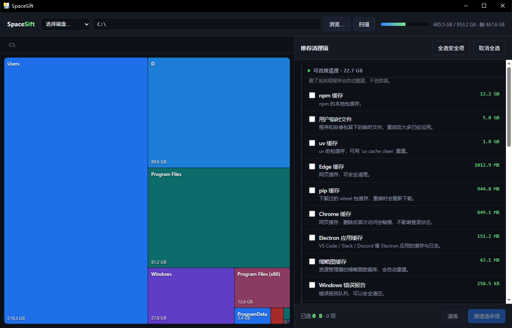

# SpaceSift · 磁盘一键清理

[](https://www.python.org/)
[](LICENSE)
[](tests/)
[](pyproject.toml)

> **sift** /sɪft/ —— 筛。把一堆东西过一遍筛子，留下该留的，倒掉该倒的。
>
> 名字里的 Space 是磁盘空间。合起来就是它干的唯一一件事：**把磁盘空间筛一遍。**

**先看清，再动手。**

一个纯 Python 标准库实现的磁盘空间分析 + 安全清理工具。它不会像某些「一键加速」软件那样
偷偷删你的东西，也不会把 40 GB 的工作文件当成垃圾 —— 它的工作是**先告诉你空间去哪了，
再按「能不能自动删」分档**，最后让你一条命令清掉真正的垃圾。

> 本项目最初是为了解决一台 Windows 机器 C 盘涨到 654 GB 的问题写的。
> 那次分析发现：能清的缓存只有 22 GB，而真正的大头是 **172 GB 落在桌面上的仿真结果**和
> **42 GB 忘了删的下载包**。这类问题，任何「深度清理」按钮都解决不了。

---

## 为什么不用现成的图形工具

| | SpaceSift | SpaceSniffer / WizTree | 各种「电脑管家」 |
|---|---|---|---|
| 看清楚空间去哪了 | ✅ 目录树 + 大文件 | ✅ 可视化方块（更直观） | ❌ 只给个总数 |
| 可脚本化 / 可复现 | ✅ 纯 CLI + JSON | ❌ GUI 专用 | ❌ |
| 生成可交付的报告 | ✅ Markdown / HTML | ❌ 截图 | ❌ |
| 判断哪些能安全删 | ✅ 三档风险分级 | ❌ 全要自己判断 | ⚠️ 乱删 |
| 批量清理 | ✅ 白名单 + dry-run | ❌ | ⚠️ 风险高 |

图形工具看得更爽，但**结论留不下来，也没法在几十台机器上复用**。SpaceSift 补的是这一块：
同样的输入生成同样的报告，可以进 git、可以贴到工单里、可以交给同事。

---

## 特性

- **扫得快**：`os.scandir` + 后序遍历，C 盘 320 万文件 / 624 GB 约 **44 秒**（机械硬盘会更慢）。
- **分档清楚**：
  - `safe` —— 删了系统自己重建（缓存、临时文件、崩溃转储）
  - `caution` —— 有副作用（回收站、旧系统、pnpm 存储）
  - `manual` —— 工具永远不动，只给命令（休眠文件、页面文件、微信文件、大模型）
  - 外加一类 `archive` —— **不是垃圾，是放错盘的大文件**
- **默认不删**：`spacesift clean` 是演练，必须 `--yes` 才动手。
- **有图形界面**：`spacesift ui` 起一个本地网页，方块图 + 勾选清单，零依赖。
- **白名单删除**：只删规则表里声明过的路径，且逐条校验绝对路径。
- **零依赖**：只用标准库，`python -m spacesift` 直接跑，不需要装任何东西。
- **跨平台**：Windows 为主，Linux / macOS 的缓存规则也一并支持。

---

## 快速开始

**Windows 用户最省事：** 去 [Releases](https://github.com/Twofruitsgrape/spacesift/releases) 下载
`SpaceSift.exe`，双击就能用，不用装 Python。

### 从源码跑

```bash
git clone https://github.com/Twofruitsgrape/spacesift.git
cd spacesift
pip install ".[gui]"        # 只想要命令行就把 [gui] 去掉
spacesift --version
```

> `[gui]` 会装 pywebview（原生窗口用）。exe 发行版已经把运行时打进去了，
> 所以下载 exe 的人不需要这一步。

---

## 图形界面（第一次用就走这里）

**双击 `SpaceSift.exe` 就行。** 14 MB 单文件，原生窗口，自带 Python 运行时和界面素材，
不写注册表、不装服务、不联网。或者装了 Python 的话：

```bash
spacesift gui
```



- 路径可以**手动输入**，也可以用左边的**磁盘下拉**选整块盘，或点 **浏览…** 弹系统文件夹对话框；
- 扫描时方块**一块块长大**（边扫边画），不是盯着一个转圈；
- 左边方块图面积 = 占用，点方块下钻，面包屑返回；
- 右边推荐清理项按四档分组，**默认只勾 `safe`**，`caution` 留给你决定，
  `archive` / `manual` **没有勾选框**；
- 勾选后底部实时显示「已选 X GB」，先点 **演练** 看效果，再点 **清理选中项** 才真删，
  真删前有二次确认弹窗。

界面是 40 KB 的 HTML，用系统自带的 WebView2 渲染（Windows 10/11 都有），
所以体积只有 Electron 应用的十分之一。

---

## 用法（命令行）

### 1. 先看一眼

```bash
spacesift
```

```
C:\  953.2 GB 总容量 · 654.6 GB 已用 · 298.5 GB 可用 (68.7%)
  扫描到 623.6 GB / 3,213,809 个文件 （43.7s，862 个目录无权访问）

  空间去向：
      389.0 GB  Users
       89.6 GB  D
       81.2 GB  Program Files
       27.8 GB  Windows
       12.6 GB  Program Files (x86)

       22.5 GB  可直接清理
       14.1 GB  确认后清理
      184.8 GB  可归档
       98.3 GB  需人工
```

### 2. 只扫描某个目录

```bash
spacesift scan "C:/Users/me/Desktop" --depth 3 --top 20 --json scan.json
```

### 3. 检测可清理项

```bash
spacesift detect
spacesift detect --only npm-cache,user-temp     # 只看这两条
spacesift detect --json findings.json
```

### 4. 清理（默认演练）

```bash
spacesift clean                                  # 只统计，一个字节都不删
spacesift clean --yes                            # 真清 safe 级
spacesift clean --only npm-cache --yes           # 只清 npm 缓存
spacesift clean --yes --include-caution          # 连 caution 级一起清
```

### 5. 生成报告

```bash
spacesift report --out report.md --html
spacesift report --scan-json scan.json --out report.html   # 复用已有扫描结果
```

Markdown 适合贴到 issue / 文档里，HTML 是单文件、无外部依赖，双击就能看。

### 6. 归档大文件（`tools/migrate.py`）

清缓存只能拿回几 GB。真正的空间往往躺在「放错盘的大文件」上 —— 报告里的 `archive`
那一档就是它们。这个脚本负责搬：

```bash
# 演练：看看会搬哪些（1 GB 以上的）
python tools/migrate.py --src "C:/Users/me/Desktop/models" --dst "D:/models"

# 真搬：复制 → 比大小 → 比 SHA256 → 三项全过才删源
python tools/migrate.py --src "C:/Users/me/Desktop/models" --dst "D:/models" \
    --min-size 1G --execute --delete-source
```

它用 robocopy `/J /Z` 复制（无缓冲 IO + 断点续传），逐文件校验后才删源文件，
所以中断了重跑是安全的。

---

## 安全设计

这个工具会删文件，所以安全性比功能重要。四条防线：

1. **规则表写死在代码里**（`src/spacesift/rules.py`），不从配置文件读。想加规则得改代码，
   这样「不知从哪来的一条 YAML 把 `C:\` 写进去」这种事故不可能发生。
2. **删除前双重校验**（`src/spacesift/clean.py`）：
    - 目标必须落在该规则 `paths` 展开后的结果里 —— 调用方传啥都没用；
    - 目标不能是受保护路径 —— 盘符根、`C:\Windows`、`System32` 整棵子树、
      `Program Files`、`ProgramData` 一等一拒绝。
3. **不跟随链接**：junction / 符号链接只跳过不进入，防止通过别名删到系统目录。
4. **默认 dry-run**，且 `manual` 级永远不进批量清理。

`tests/test_clean.py` 专门验证这些：规则外的路径、受保护的路径、dry-run、只读文件、
递归删除的目录顺序 —— 46 个测试全绿。

> ⚠️ 清 `Windows 更新下载缓存`、`组件存储备份` 需要管理员权限。
> 后者请用微软自己的 `DISM /Online /Cleanup-Image /StartComponentCleanup`，
> 手删 `WinSxS` 会把系统搞坏，本项目只做检测和提示。

---

## 报告长什么样

`docs/sample-report.md` 是一份脱敏的真实输出（用户目录名换成 `me`，项目名做了替换），
同目录的 `sample-report.html` 是可视化版。配套的 `docs/assets/spacesniffer-c-scan.png`
是同一台机器用 SpaceSniffer 扫出来的方块图，可以和报告对照着看。

```
| 目录              | 占用      | 占比   |
|-------------------|-----------|--------|
| Users             | 389.0 GB  | 62.4%  |
| D                 | 89.6 GB   | 14.4%  |
| Program Files     | 81.2 GB   | 13.0%  |
| Windows           | 27.8 GB   | 4.5%   |
```

配合同目录下的 `C盘清理分析报告.html`（可视化版）和 `assets/spacesniffer-c-scan.png`
（SpaceSniffer 的方块图，用来对照）。

---

## 内置规则

| 分类 | 规则 |
|---|---|
| 临时文件 | 用户 TEMP、Windows\Temp、崩溃转储、Windows 错误报告 |
| 包管理器缓存 | npm、pip、uv、pnpm（caution） |
| 浏览器 | Chrome / Edge 缓存、Chrome 端侧 AI 模型（caution） |
| 系统 | Windows 更新下载缓存、传递优化、缩略图缓存、日志（caution）、WinSxS 备份（caution） |
| 回收站 / 旧系统 | 回收站（caution）、Windows.old（caution） |
| 只报告 | 下载文件夹、微信 / QQ 文件、WSL 镜像、休眠文件、页面文件、系统还原点 |

想让工具支持新的清理项？在 `rules.py` 里加一条 `CleanRule` 就行 —— 顺便**务必**给它
选对 `risk`，宁可定成 `caution`/`manual` 也不要高估自己。

---

## 开发

```bash
uv venv .venv
uv pip install --python .venv/Scripts/python.exe -e ".[dev]"
.venv/Scripts/python.exe -m pytest
```

> Windows 上如果 `TMP`/`TEMP` 指向 MSYS 的 `/tmp`，pytest 的 `tmp_path` 会报
> `PermissionError`。加 `--basetemp` 指到原生路径即可。

贡献前请保证 `pytest` 全绿，并为新的清理规则补一条测试。

---

## 许可证

[MIT](LICENSE) © 2026 Twofruitsgrape

工具会删文件，请先在虚拟机或非生产机器上验证 `--yes` 的效果。
